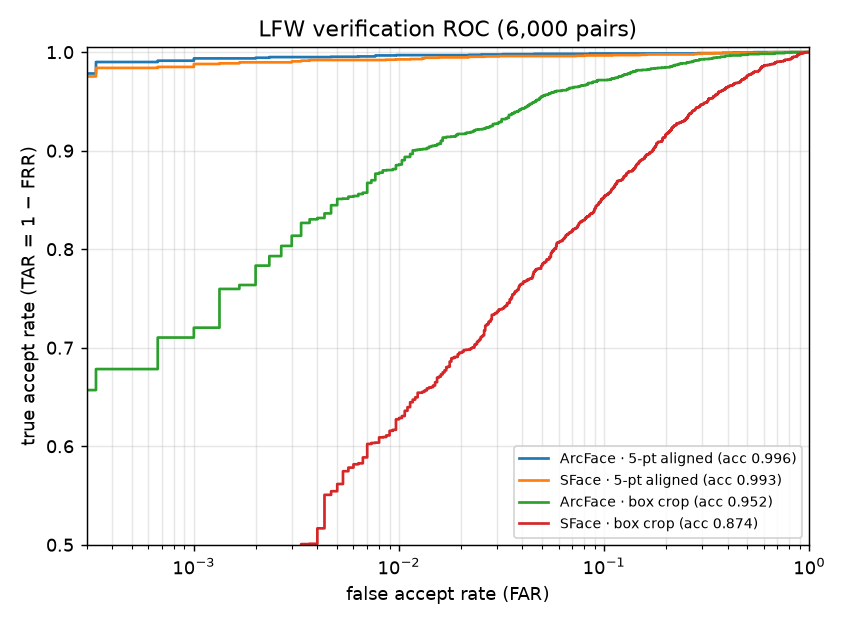
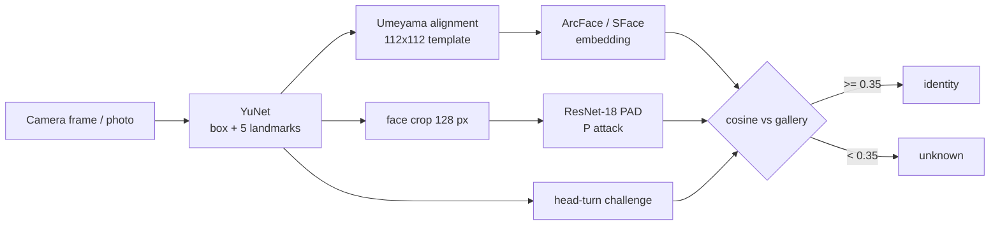
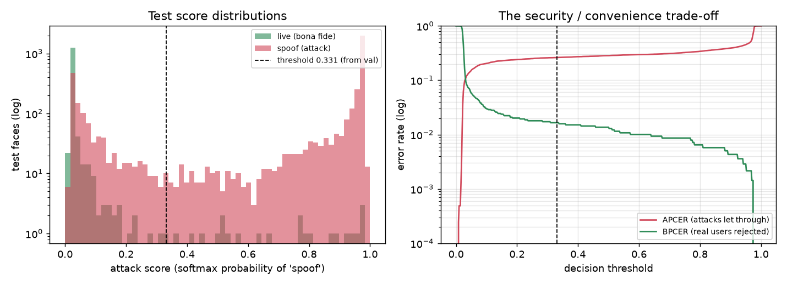

<div align="center">

# Face Recognition and Anti-Spoofing

Face verification and open-set identification on LFW (YuNet detection, 5-point alignment, ArcFace/SFace embeddings), plus a CelebA-Spoof presentation-attack detector and a head-turn liveness challenge.

[](https://github.com/haroonkhan02/face-recognition-antispoofing/actions/workflows/ci.yml)




<sub>LFW verification ROC on 6,000 pairs. Same detector and networks; only the face crop differs.</sub>

</div>

> **Use responsibly.** Enrol only yourself and people who have agreed. Face templates are biometric data (GDPR Art. 9 in the EU/UK). This is a learning project with no demographic-bias evaluation. See [Privacy and ethics](#privacy-and-ethics).

## What it does

- Detects a face with OpenCV YuNet, aligns it to the ArcFace 5-point template with my own Umeyama similarity transform, and embeds it with ArcFace (512-d) or SFace (128-d). A gallery stores embeddings only, never photos.
- Evaluates verification with the standard LFW 10-fold protocol (ROC, EER, TAR at fixed FAR) and measures what alignment is worth.
- Runs open-set identification: a face is matched against an enrolled gallery or rejected as unknown.
- Trains a ResNet-18 presentation-attack detector on a CelebA-Spoof subset and reports APCER/BPCER/ACER with the threshold fixed on validation.
- Adds a randomised turn-left/turn-right liveness challenge from the five landmarks, a webcam access-control app and a Gradio demo.



## Results

### LFW verification (6,000 pairs, 10-fold)

| Embedder | Crop | Accuracy | EER | TAR @ FAR 10⁻³ |
|---|---|---|---|---|
| ArcFace MobileFaceNet (512-d) | 5-point aligned | 99.55 % ± 0.34 | 0.47 % | 99.37 % |
| SFace (128-d) | 5-point aligned | 99.32 % ± 0.40 | 0.80 % | 98.80 % |
| ArcFace | detector box | 95.23 % ± 0.79 | 4.83 % | 72.03 % |
| SFace | detector box | 87.37 % ± 1.30 | 12.60 % | 42.07 % |

Alignment is worth 4.3 points for ArcFace and 12 points for SFace. At FAR 10⁻³ the un-aligned crops reject 28 % and 58 % of genuine users. ArcFace takes 2.0 ms for detection plus alignment and 4.3 ms per embedding on CPU. With 3,000 impostor pairs, FAR 10⁻³ rests on 3 pairs, so treat it as indicative. All fields are in `reports/lfw/results.json`.

### Open-set identification (ArcFace, aligned)

The gallery holds one photo each of the 1,680 LFW people with at least two photos. The probes are 7,484 other photos of those people and 4,069 photos of people who were never enrolled. DIR is the share of known probes matched to the right person; FPIR is the share of strangers matched to anyone.

| Threshold | DIR | FPIR |
|---|---|---|
| none (closed-set rank-1) | 99.53 % | n/a |
| 0.25 (the 1:1 threshold at FAR 10⁻³) | 99.44 % | 43.4 % |
| 0.35 (used by the app) | 98.17 % | 0.76 % |
| 0.629 (FPIR 0.1 %) | 39.9 % | 0.1 % |

A threshold that gives FAR 10⁻³ for one comparison lets 43 % of strangers through against 1,680 people, so 1:N needs its own, stricter threshold. The strangers that match best are mostly labelling errors in LFW: three pairs are the same man under two spellings and one is the Olsen twins (`reports/lfw/hardest_strangers.jpg`).

### Presentation-attack detection (CelebA-Spoof subset)

ResNet-18, 128 px crops, 8 epochs (about 7 minutes per model on MPS). Train 18,064, validation 5,194, test 5,466 images. The threshold is the equal-error point on validation; test is never used for tuning. APCER is attacks accepted as live, BPCER is live faces rejected.

| Crop context (x face box) | val EER | test EER | test APCER | test BPCER | AUC |
|---|---|---|---|---|---|
| x1.0 | 1.60 % | 8.2 % | 24.6 % | 1.7 % | 0.952 |
| x1.6 (default) | 1.72 % | 10.7 % | 26.2 % | 1.7 % | 0.935 |
| x2.4 | 1.48 % | 15.1 % | 31.5 % | 1.9 % | 0.896 |

<p align="center"></p>

Validation EER is 1.5 to 1.7 % while test EER is 8 to 15 %. An identity-overlap check (`python -m faceauth.leakage`, which embeds each face and looks for a training identity) explains why: 77 % of sampled validation faces match a training identity, against 22 % of test faces (0.6 % strong matches on test, 34 % on validation). The validation split leaks people, so the threshold is calibrated on a population the test set doesn't resemble, and about a quarter of attacks get through. More background context improved the leaky validation score and hurt on test. The x1.0 crop tests best, but I chose x1.6 before testing and kept it, since switching afterwards would be tuning on the test set.

CelebA-Spoof here is a laptop-sized subset (about 5 % of the images) from a mirror without subject IDs or attack-type labels, so APCER can't be broken down per attack type. LFW is near-saturated and skewed towards lighter-skinned, male public figures; 99.5 % there says nothing about other groups. One seed per configuration.

## Repository structure

```text
face-recognition-antispoofing/
├── src/faceauth/
│   ├── detect.py, align.py, embed.py   # YuNet, Umeyama alignment, ArcFace/SFace
│   ├── metrics.py                      # FAR/FRR, ROC, EER, TAR@FAR, APCER/BPCER/ACER
│   ├── verify.py                       # LFW 10-fold protocol and alignment ablation
│   ├── gallery.py                      # enrol / identify, 1:1 and 1:N thresholds
│   ├── spoof_data.py, train_spoof.py   # CelebA-Spoof crops, ResNet-18 PAD training
│   ├── evaluate_spoof.py, leakage.py   # ISO 30107-3 metrics, identity-overlap check
│   ├── liveness.py                     # randomised head-turn challenge
│   └── app.py, demo.py                 # webcam access control, Gradio demo
├── configs/                            # spoof_resnet18.yaml
├── tests/                              # 20 unit tests on synthetic data
├── reports/                            # lfw/ and spoof/ results and figures
└── .github/workflows/                  # ruff + pytest on Python 3.10-3.12
```

## Getting started

```bash
git clone https://github.com/haroonkhan02/face-recognition-antispoofing.git
cd face-recognition-antispoofing
uv venv --python 3.12 && source .venv/bin/activate
uv pip install -e ".[demo,dev]"

faceauth-download models          # YuNet, SFace, ArcFace (~54 MB)
faceauth-download lfw             # 173 MB
faceauth-lfw                      # ArcFace/SFace x aligned/box crop (~6 min, CPU)
faceauth-identify --benchmark-lfw # open-set identification (~4 min, CPU)

faceauth-download celeba-spoof    # 11 parquet shards, ~4.7 GB
faceauth-prepare-spoof
faceauth-train-spoof              # ~7 min per model on an Apple M5 (MPS)
faceauth-evaluate-spoof
python -m faceauth.leakage

faceauth-enroll me selfie1.jpg selfie2.jpg   # consenting people only
faceauth-webcam                              # q = quit, r = restart challenge
faceauth-demo                                # http://127.0.0.1:7860
pytest && ruff check .                       # no models, data or camera needed
```

## Design decisions

| Decision | Why |
|---|---|
| YuNet and my own Umeyama alignment, not a black-box library | Every step is inspectable and the ablation shows what alignment buys. |
| Separate 1:1 and 1:N thresholds | False alarms grow with gallery size, roughly as `1 - (1 - FAR)^N`. |
| Gallery stores normalised mean templates, not photos | Data minimisation. |
| PAD threshold fixed on validation and saved in the checkpoint | The test split never tunes anything, which is why the generalisation gap is visible. |
| Crops slide inside the photo instead of black padding | Black padding was more common on spoof images, a shortcut the CNN would learn. |
| Gentle augmentation for PAD | Colour casts, blur and moiré are the attack cues; strong photometric augmentation erases them. |
| Identity-overlap check with the project's own recogniser | The mirror has no subject IDs, so face recognition audits the split. |
| Randomised head-turn challenge | A static photo can't turn, and a pre-recorded video doesn't know the order. |

## Privacy and ethics

- **Consent and law.** Enrol only people who agreed. In the EU/UK, face templates are special-category biometric data (GDPR Art. 9): you need explicit consent or another legal basis, a stated purpose, a retention period and deletion on request.
- **Data minimisation.** The gallery (`data/gallery/gallery.npz`, git-ignored) holds embeddings only. Inference runs locally and nothing is uploaded.
- **Bias.** LFW and CelebA are mostly lighter-skinned adult public figures, and independent evaluations such as NIST FRVT found large differences in false-match rates across demographic groups for many algorithms. This project has no demographic evaluation, so its error rates must not be assumed to hold for everyone.
- **Licences.** LFW and CelebA images were collected from the web without their subjects' consent to biometric research. CelebA-Spoof and the InsightFace ArcFace weights are non-commercial research only; weights are downloaded at run time and not redistributed.

## Limitations and future work

- Identity-disjoint validation for the PAD model: cluster training faces by ArcFace identity, hold out whole clusters, then reselect the threshold and crop scale.
- Per-attack-type APCER with the official CelebA-Spoof labels, and cross-dataset tests on my own phone-replay videos.
- A per-group FAR/FRR evaluation (for example RFW, which needs a request form).
- An approximate nearest-neighbour index to time 1:N search at 100k+ templates, and an eye-blink challenge next to the head turn.

## Acknowledgements

[LFW](http://vis-www.cs.umass.edu/lfw/) (Huang et al., 2007) · [CelebA-Spoof](https://github.com/ZhangYuanhan-AI/CelebA-Spoof) (Zhang et al., ECCV 2020; mirror [Ar4ikov/celebA_spoof](https://huggingface.co/datasets/Ar4ikov/celebA_spoof)) · [ArcFace](https://arxiv.org/abs/1801.07698) (Deng et al., CVPR 2019) with weights from [InsightFace](https://github.com/deepinsight/insightface) · [YuNet and SFace](https://github.com/opencv/opencv_zoo) from OpenCV Zoo · Umeyama, IEEE TPAMI 1991

## License

[MIT](LICENSE) © Muhammad Haroon Khan (code only; datasets and model weights keep their own licences)
