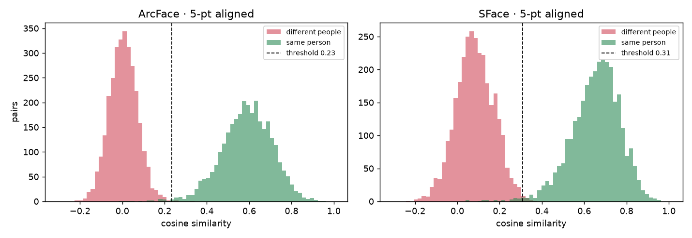
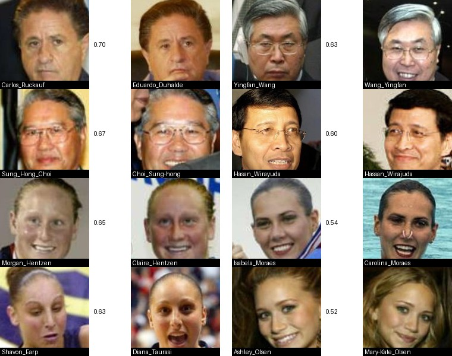
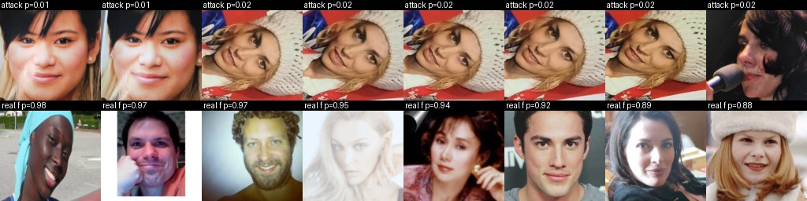
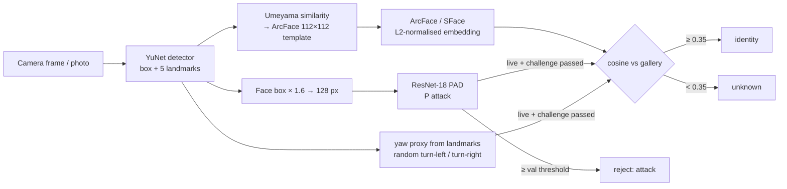

<div align="center">

# 🙂 Face Recognition + Anti-Spoofing: measured the way biometrics should be

**Face verification and open-set identification (YuNet detection → 5-point Umeyama alignment → ArcFace / SFace embeddings) evaluated on LFW with FAR/FRR, EER and TAR@FAR, plus a CelebA-Spoof presentation-attack detector reported with ISO 30107-3 metrics and a randomised head-turn liveness challenge.**

[](https://github.com/haroonkhan02/face-recognition-antispoofing/actions/workflows/ci.yml)


<sub>LFW verification ROC on 6,000 pairs. Same detector, same networks: only the face crop differs.</sub>

</div>

> 🔒 **Use responsibly.** Enrol only yourself and people who have agreed. Face templates are biometric data (GDPR Art. 9 in the EU/UK). This is a learning project with no demographic-bias evaluation; it is not a product. See [Privacy & ethics](#privacy--ethics).

---

## Highlights

- **Full pipeline, built from parts you can explain**: OpenCV YuNet detector → my own Umeyama similarity alignment to the ArcFace 5-point template → ArcFace (512-d, ONNX) or SFace (128-d) embeddings → cosine matching against a gallery that stores embeddings, never photos.
- **Proper verification protocol**: LFW 10-fold (threshold chosen on 9 folds, tested on the 10th), ROC, EER and **TAR at FAR = 10⁻³**, plus an alignment ablation: alignment is worth **+4.3 points** for ArcFace and **+12 points** for SFace.
- **Open-set identification**, the setting real systems face: the 1:1 threshold lets **43 % of strangers** match *someone* in a 1,680-person gallery, so 1:N gets its own threshold. The hardest "strangers" turned out to be **LFW labelling errors**.
- **Presentation-attack detection** on CelebA-Spoof with APCER / BPCER / ACER at a validation-fixed threshold, a crop-context ablation, and an identity-overlap check that **exposes a leaky validation split**: 77 % of validation faces belong to training identities vs. 22 % of test faces.
- **Active liveness**: a randomised "turn left / turn right" challenge computed from the 5 landmarks; a webcam access-control app and a Gradio demo tie everything together.
- **Tested without data**: 20 unit tests on synthetic landmarks, scores and parquet shards (Umeyama recovery, mirror guard, metric identities, open-set gallery, liveness state machine, crop-stays-inside-photo) run in CI on Python 3.10–3.12.

## Results

All numbers come from runs in this repo on an Apple M5 (`faceauth-lfw`, `faceauth-identify --benchmark-lfw`, `faceauth-train-spoof`, `faceauth-evaluate-spoof`, `python -m faceauth.leakage`). Embedding times are on CPU (onnxruntime / OpenCV DNN).

### 1 · LFW verification (6,000 pairs, 10-fold)

| Embedder | Crop | Accuracy (mean ± std) | AUC | EER | TAR @ FAR 10⁻² | TAR @ FAR 10⁻³ |
|---|---|---|---|---|---|---|
| **ArcFace MobileFaceNet (512-d)** | **5-pt aligned** | **99.55 % ± 0.34** | 0.9994 | 0.47 % | 99.70 % | **99.37 %** |
| SFace (128-d) | 5-pt aligned | 99.32 % ± 0.40 | 0.9988 | 0.80 % | 99.27 % | 98.80 % |
| ArcFace MobileFaceNet | detector box | 95.23 % ± 0.79 | 0.9892 | 4.83 % | 88.60 % | 72.03 % |
| SFace | detector box | 87.37 % ± 1.30 | 0.9455 | 12.60 % | 62.87 % | 42.07 % |

<sub>Every field is in `reports/lfw/results.json`. Detection found a face in all 7,701 pair images. ArcFace: detection + alignment 2.0 ms, embedding 4.3 ms per face (CPU, batched). With 3,000 impostor pairs, FAR 10⁻³ is decided by 3 pairs; treat it as indicative.</sub>

<p align="center"></p>

### 2 · Open-set identification on LFW (ArcFace, aligned)

Gallery = first photo of each of the **1,680** people with ≥ 2 photos; **7,484** known probes (their other photos); **4,069** unknown probes (people with one photo, never enrolled). DIR = known probes matched to the right person above the threshold; FPIR = unknown probes matched to anyone above it.

| Threshold | DIR (enrolled people found) | FPIR (strangers let in) |
|---|---|---|
| none: closed-set rank-1 | 99.53 % | — |
| 0.25 = the 1:1 threshold (FAR 10⁻³) | 99.44 % | **43.4 %** |
| 0.343 (FPIR = 1 %) | 98.41 % | 1.0 % |
| **0.35, used by the app** | **98.17 %** | **0.76 %** |
| 0.629 (FPIR = 0.1 %) | 39.9 % | 0.1 % |

<p align="center"></p>
<p align="center"><sub>The 8 never-enrolled "strangers" (left of each pair) that best match an enrolled person (right). Three pairs are the same man under two spellings (Sung_Hong_Choi / Choi_Sung-hong, Yingfan_Wang / Wang_Yingfan, Hasan_Wirayuda / Hassan_Wirajuda) and one is the Olsen twins. These cases force the 0.629 threshold for FPIR 0.1 %: the model isn't wrong there, the labels are.</sub></p>

### 3 · Presentation-attack detection on CelebA-Spoof (subset)

ResNet-18 (ImageNet), 128 px crops, 8 epochs (6.8 min each on MPS). Train 18,064 / validation 5,194 / **test 5,466** images (66 / 66 / 75 % attacks). The decision threshold is fixed on **validation** at its equal-error point; test is never used for tuning. APCER = attacks accepted as live, BPCER = live faces rejected.

| Crop context (× face box) | val EER | **test EER** | test APCER @ val thr. | test BPCER @ val thr. | ACER | AUC | BPCER20 |
|---|---|---|---|---|---|---|---|
| ×1.0 (face only) | 1.60 % | **8.2 %** | 24.6 % | 1.7 % | 13.1 % | 0.952 | 36.3 % |
| ×1.6 (default) | 1.72 % | 10.7 % | 26.2 % | 1.7 % | 13.9 % | 0.935 | 56.9 % |
| ×2.4 | 1.48 % | 15.1 % | 31.5 % | 1.9 % | 16.7 % | 0.896 | 74.2 % |

<p align="center"></p>

**Why validation looks perfect and test doesn't**: an identity-overlap check (`python -m faceauth.leakage`) embeds every face with the ArcFace model above and asks whether it matches a *training* identity at the 1:N threshold.

| Split | Faces matching a training identity (cos ≥ 0.35) | Strong matches (cos ≥ 0.6) | Median best similarity |
|---|---|---|---|
| validation (2,000 sampled) | **77.3 %** | 34.0 % | 0.50 |
| test (2,000 sampled) | 21.8 % | **0.6 %** | 0.31 |

<p align="center"></p>
<p align="center"><sub>Top: attacks the ×1.6 model accepted with the most confidence: clean, high-resolution prints and replays (CelebA-Spoof re-photographs the same source image on several devices, hence the repeats). Bottom: real faces it rejected: washed-out light, a photo with a white border, strong colour casts.</sub></p>

**What the numbers say**

- **Alignment is not a detail.** The networks were trained on crops aligned to a 5-point template. Feeding them the raw detector box costs ArcFace 4.3 points of accuracy and SFace 12 points, and at a realistic operating point (FAR 10⁻³) it rejects 28 % / 58 % of genuine users.
- **1:N needs a stricter threshold than 1:1.** An unknown face is compared with every enrolled template, so false alarms grow roughly as `1 − (1 − FAR)^N`. The threshold that gives FAR 10⁻³ for one comparison lets 43 % of strangers through against 1,680 people. Two constants in the code (`VERIFY_THRESHOLD` 0.25, `IDENTIFY_THRESHOLD` 0.35) make the difference explicit.
- **At very low error rates, benchmark label noise dominates.** The top false matches are the same people filed under two names, plus a pair of identical twins. Look at your "worst errors" before tuning for them.
- **The anti-spoofing validation split leaked identities, and that hid a large generalisation gap.** 77 % of validation faces belong to people seen in training (34 % with strong similarity), vs. 0.6 % strong matches on test. Validation EER (1.5–1.7 %) therefore measures recognition of *known people and their recording sessions*; on new people the test EER is 8–15 % and a quarter of attacks pass at the validation-fixed threshold, while BPCER stays at the intended ~2 %. The threshold is calibrated for the wrong population.
- **More context helped on the leaky validation set and hurt on test** (test EER 8.2 % → 15.1 % from ×1.0 to ×2.4). More background makes it easier to memorise *scenes*, which doesn't transfer to new people. ×1.0 tests best, but I picked ×1.6 before testing and keep it as the default: switching now would be choosing on the test set. The fix is an identity-disjoint validation split (see Future work), not a different number.

> **Caveats.** CelebA-Spoof here is a laptop-sized subset (≈ 5 % of the images) from a Hugging Face mirror without subject IDs or attack-type labels, so APCER can't be reported per attack type as ISO 30107-3 asks, and the test set's subject separation from training comes from the original release, not from my own check. LFW is near-saturated and demographically skewed (mostly lighter-skinned, male public figures); 99.5 % there says nothing about error rates for other groups. One seed per configuration.

## How it works



**Alignment.** `align.umeyama` solves the least-squares similarity transform (rotation, uniform scale, translation) from the detected landmarks to the template in closed form via an SVD, with a determinant check so it never mirrors the face.

**Verification metrics.** A pair's cosine similarity is a score; a threshold turns it into accept/reject. FAR = impostor pairs accepted, FRR = genuine pairs rejected, TAR = 1 − FRR. The accuracy-optimal threshold is placed mid-gap between scores (taking the score itself rejects held-out genuine pairs that land just below it).

**Liveness.** Passive: the PAD CNN averages its attack probability over the last 8 frames. Active: `liveness.HeadTurnChallenge` asks for two turns in a random order within 8 s, using `(nose_x − eye-midpoint_x) / inter-eye distance` as a yaw proxy. A printed photo can't turn, and a pre-recorded video doesn't know the order.

## Repository structure

```text
face-recognition-antispoofing/
├── src/faceauth/
│   ├── detect.py         # YuNet wrapper: boxes, 5 landmarks, scores
│   ├── align.py          # Umeyama similarity transform -> ArcFace 112x112 template; box-crop baseline
│   ├── embed.py          # ArcFace (onnxruntime) and SFace (OpenCV) embedders, cosine
│   ├── metrics.py        # FAR/FRR, ROC, AUC, EER, TAR@FAR, APCER/BPCER/ACER
│   ├── verify.py         # LFW 10-fold protocol + alignment ablation -> reports/lfw/
│   ├── gallery.py        # Enrol / identify, 1:1 and 1:N thresholds, open-set LFW benchmark
│   ├── spoof_data.py     # CelebA-Spoof parquet -> in-photo face crops at 3 context scales
│   ├── train_spoof.py    # ResNet-18 PAD training, threshold fixed on validation
│   ├── evaluate_spoof.py # ISO 30107-3 metrics, BPCER20/100, error gallery -> reports/spoof/
│   ├── leakage.py        # Identity-overlap check between train and val/test
│   ├── liveness.py       # Randomised head-turn challenge from landmarks
│   ├── app.py            # Webcam access control: PAD -> challenge -> identify
│   ├── demo.py           # Gradio: "same person?" and "real or spoof?"
│   ├── download.py · plots.py · config.py
├── configs/              # spoof_resnet18.yaml
├── tests/                # 20 unit tests on synthetic data (no models / data / camera)
├── reports/              # lfw/ and spoof/ results JSON + figures
├── data/  models/        # Datasets, ONNX models, checkpoints, gallery (git-ignored)
└── .github/workflows/    # CI: ruff + pytest on Python 3.10–3.12
```

## Getting started

```bash
git clone https://github.com/haroonkhan02/face-recognition-antispoofing.git
cd face-recognition-antispoofing
uv venv --python 3.12 && source .venv/bin/activate
uv pip install -e ".[demo,dev]"

faceauth-download models          # YuNet, SFace, ArcFace (InsightFace buffalo_sc) ~54 MB
faceauth-download lfw             # 173 MB
faceauth-lfw                      # 4 runs: ArcFace/SFace x aligned/box crop (~6 min, CPU)
faceauth-identify --benchmark-lfw # open-set identification (~4 min, CPU)

faceauth-download celeba-spoof    # 11 parquet shards, ~4.7 GB
faceauth-prepare-spoof            # face crops at x1.0 / x1.6 / x2.4 (~1 min)
faceauth-train-spoof              # ~7 min per model on an Apple M5 (MPS)
faceauth-evaluate-spoof
python -m faceauth.leakage        # identity overlap train vs val/test (~2 min, CPU)

faceauth-enroll me selfie1.jpg selfie2.jpg   # consenting people only
faceauth-webcam                              # q = quit, r = restart challenge
faceauth-demo                                # http://127.0.0.1:7860
```

## Design decisions

| Decision | Why |
|---|---|
| YuNet + my own Umeyama alignment instead of a black-box face library | Every step is inspectable and testable; the ablation shows exactly what alignment buys. |
| Two embedders (ArcFace 512-d, SFace 128-d) | Shows how a smaller model degrades, especially without alignment. |
| Separate 1:1 and 1:N thresholds | False alarms scale with gallery size; one threshold can't serve both. |
| Gallery stores normalised mean templates, not photos | Data minimisation; a template can't be turned back into the photo directly. |
| PAD threshold fixed on validation and saved in the checkpoint | The test split never tunes anything, which is why the generalisation gap is visible at all. |
| Crops slide inside the photo instead of black padding | Black padding was more common on spoof images: a shortcut the CNN would have learned. |
| Gentle augmentation for PAD | Colour casts, blur and moiré are the attack cues; strong photometric augmentation would erase them. |
| Identity-overlap check with the project's own recogniser | The mirror has no subject IDs; face recognition can audit the split. |
| Randomised head-turn challenge | Cheap, landmark-only active liveness that a static photo can't pass. |

## Testing

```bash
pytest     # synthetic landmarks, scores and parquet shards: no models, data or camera
ruff check .
```

## Privacy & ethics

- **Consent and law.** Enrol only people who agreed. In the EU/UK, face templates are special-category biometric data (GDPR Art. 9): you need explicit consent or another legal basis, a stated purpose, a retention period and deletion on request. The EU AI Act prohibits untargeted scraping of facial images to build recognition databases and restricts real-time remote biometric identification in public spaces.
- **Data minimisation.** The gallery (`data/gallery/gallery.npz`, git-ignored) stores only embeddings. Nothing is uploaded anywhere; all inference runs locally.
- **Bias.** LFW and CelebA are mostly lighter-skinned adult public figures. Independent evaluations (e.g. NIST FRVT demographic studies) have found large differences in false-match rates across demographic groups for many algorithms. This project has **no demographic evaluation**, so its error rates must not be assumed to hold for everyone.
- **Datasets and models.** LFW and CelebA images were collected from the web without their subjects' consent to biometric research. CelebA-Spoof and the InsightFace ArcFace weights are licensed for **non-commercial research only**; the weights are downloaded at run time and not redistributed here.
- **Asymmetric harm.** A false accept can give someone else access; a false reject locks out a real user. If either happens more often for some groups, that is discrimination, not just an error rate.

## Future work

- **Identity-disjoint validation for PAD**: cluster the training faces by ArcFace identity, hold out whole clusters, and re-select the threshold and the crop scale on people the model hasn't seen
- Per-attack-type APCER with the official CelebA-Spoof labels (manual download) and cross-dataset testing on my own phone-replay videos
- Demographic evaluation (e.g. RFW, which needs a request form) of FAR/FRR per group
- An ANN index (FAISS / HNSW) to time 1:N search at 100 k+ templates
- Eye-blink challenge (MediaPipe Face Mesh eye aspect ratio) alongside the head turn

## Acknowledgements

[LFW](http://vis-www.cs.umass.edu/lfw/): Huang et al., 2007 · [CelebA-Spoof](https://github.com/ZhangYuanhan-AI/CelebA-Spoof): Zhang et al., ECCV 2020 (non-commercial research; mirror [Ar4ikov/celebA_spoof](https://huggingface.co/datasets/Ar4ikov/celebA_spoof)) · [ArcFace](https://arxiv.org/abs/1801.07698): Deng et al., CVPR 2019, weights from [InsightFace](https://github.com/deepinsight/insightface) (non-commercial) · [YuNet and SFace](https://github.com/opencv/opencv_zoo) from OpenCV Zoo · Umeyama, *Least-squares estimation of transformation parameters between two point patterns*, IEEE TPAMI 1991

## License

[MIT](LICENSE) © Muhammad Haroon Khan (code only; datasets and model weights keep their own licences)
